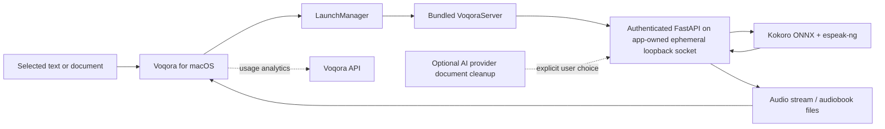

# Voqora architecture

Voqora combines a native SwiftUI Mac app with a bundled local Python speech
service. The split lets the product feel native on macOS while keeping the
speech pipeline close to the ONNX runtime it needs.

## System map

## Native app

The SwiftUI application owns the interface, global shortcuts, playback,
preferences, history, and audiobook views. It talks to the local service on an
app-owned ephemeral `127.0.0.1` socket. `BackendConnection` creates a fresh
256-bit token and listener for every backend launch, passes the inherited FD
only to that child, and adds the token as an HTTP header to every local
request. The speech request never needs an external speech endpoint.

On launch, `LaunchManager` extracts the bundled server archive into the
application-support directory for the current bundle identifier.
`BackendService` starts the executable, waits for its health endpoint, and
streams audio back to the app for playback.

## Speech path

1. The app receives selected or pasted text.
2. It posts a local request to the bundled FastAPI service.
3. The service segments the text and runs Kokoro ONNX inference.
4. Generated audio is returned progressively.
5. The native audio service schedules the received buffers for playback.

Inference is intentionally serialized around the phonemizer/runtime boundary.
The useful overlap is between playback of one completed segment and generation
of the next, rather than running unsafe concurrent inference.

## Audiobook path

The audiobook service extracts a document, processes pages, creates audio, and
persists local metadata needed for progress and resume. Local extraction is the
default. Optional LLM cleanup and OCR are invoked only with a user-connected
provider and an explicit selection of that workflow. `llm_providers.py` holds
the provider registry (OpenAI, Anthropic, xAI, Groq, Cerebras, Google,
OpenRouter, Ollama, LM Studio, and Custom), server-URL checks, and the
OpenAI-compatible and Anthropic transports; Gemini keeps its SDK path in
`llm_cleaner.py` for the Flex service tier.

The app stores each provider's key in the macOS login Keychain and sends the
active provider, model, and key as request headers to the local service on
every cleanup request. The service does not persist them. Ollama, LM Studio,
and Custom servers on this computer or network keep page text off the internet.
Cleanup failures are reported with a reason so the app can offer to fix the
provider, resume, or finish the book without AI.

Chapters come from DOCX and Markdown headings and from PDF outlines, with a
"Part N" fallback. Scanned pages inside text PDFs are routed to OCR when a
provider is available.

## Languages and voices

`languages.py` holds the catalog of 28 voices in eight languages. The first
letter of a voice ID selects the espeak-ng language used for phonemization
(for example `b` is `en-gb` and `z` is `cmn`), so the client sends no separate
language field. The app can optionally switch voices when the text is in a
different language.

## Local stats

`UsageStatsStore` keeps listening time, voice use, and library totals in
`usage-stats.json` in the app's support directory. It is never sent to the
analytics server and is cleared by Erase All Local Data.

## Key directories

| Path | Responsibility |
| --- | --- |
| `frontend/Voqora/Voqora/` | SwiftUI app, native services, views, and assets. |
| `backend/app/` | FastAPI routes and auth middleware, config, local engine, audiobook service, and storage. |
| `backend/tests/` | Fast backend tests. |
| `frontend/Voqora/VoqoraTests/` | Swift unit and service tests. |
| `scripts/` | Backend packaging, DMG creation, release shipping, and benchmarks. |
